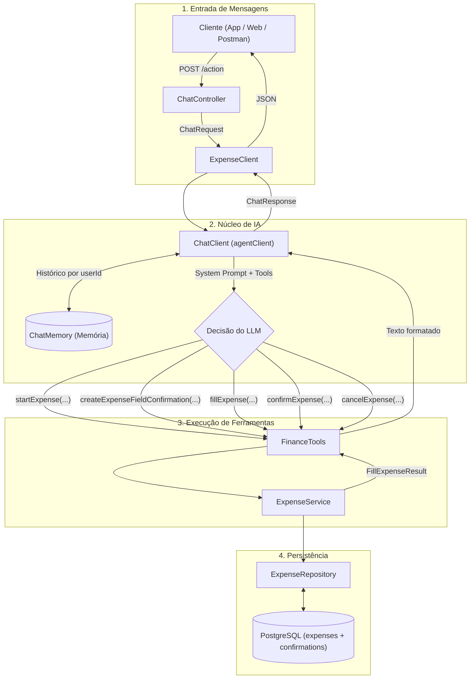
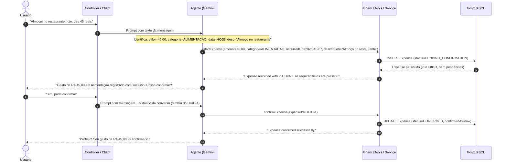
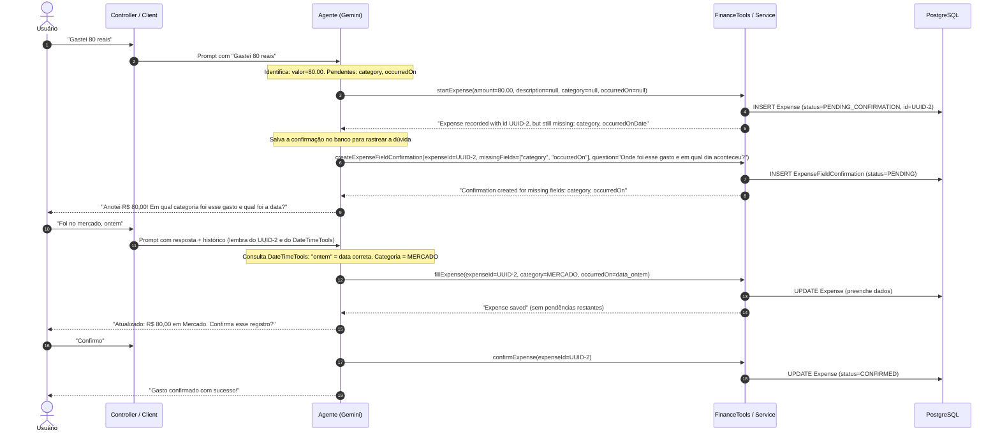
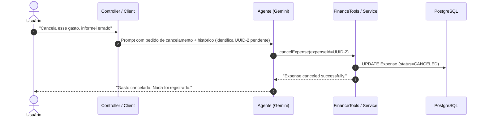

# VoiceFinance - Registro Inteligente de Gastos com IA

<p align="left">
  
  
  
  
  
  
  
  
  
  
</p>

Plataforma inteligente de gestão financeira e registro de gastos via linguagem natural, orientada a agentes autônomos com Spring AI e Google Gemini. O sistema orquestra ferramentas de persistência e validação para capturar despesas via texto, levantar dúvidas sobre dados faltantes de forma interativa, manter histórico de conversação por usuário e assegurar confirmação explícita antes da gravação definitiva no PostgreSQL.

---

## 📌 Sobre o Projeto

O **VoiceFinance** simplifica a anotação de despesas do dia a dia, eliminando formulários manuais extensos. O usuário apenas envia mensagens em linguagem natural (ex.: *"Gastei 45 reais no almoço hoje"*), e o agente de IA:
1. Extrai valor, moeda, categoria, data e descrição;
2. Verifica se algum dado essencial está ausente;
3. Cria pendências formais de esclarecimento no banco caso faltem informações;
4. Pergunta de forma objetiva o que falta e assimila as respostas seguintes;
5. Solicita validação final do usuário antes de oficializar o registro.

---

## 🏗️ Arquitetura da Fase 1 (Texto)

A arquitetura organiza a separação clara entre a camada de entrada HTTP, o núcleo de IA com memória contextual e a camada de serviços e persistência:



---

## 🔄 Fluxos de Conversação

### Fluxo 1: Gasto Completo em Mensagem Única
Quando o usuário fornece todos os atributos necessários na primeira frase:



---

### Fluxo 2: Gasto Incompleto e Rodada de Esclarecimento
Quando o usuário omite campos (por exemplo, diz o valor, mas não a categoria nem a data):



---

### Fluxo 3: Descarte ou Cancelamento
Quando o usuário opta por não prosseguir com o lançamento:



---

## 🛠️ Ferramentas do Agente (Function Calling)

As ferramentas disponibilizadas para o modelo atuam como a fronteira entre a linguagem natural e o banco relacional:

| Ferramenta | Descrição |
| :--- | :--- |
| **`startExpense`** | Cria um novo registro no banco com status `PENDING_CONFIRMATION`, garantindo que o agente receba um `expenseId` real de volta. |
| **`createExpenseFieldConfirmation`** | Registra formalmente no banco as dúvidas do agente para os campos pendentes de um gasto. |
| **`fillExpense`** | Atualiza os campos de um gasto existente à medida que o usuário envia mensagens complementares. |
| **`confirmExpense`** | Efetiva o gasto, alterando seu status para `CONFIRMED` e registrando a data/hora da confirmação. |
| **`cancelExpense`** | Altera o status do gasto para `CANCELED` em caso de desistência do usuário. |
| **`DateTimeTools`** | Utilitários de data e hora para resolver referências temporais relativas (*"ontem"*, *"segunda-feira passada"*, limites de mês). |

---

## 🚀 Como Executar o Projeto

### Pré-requisitos
- **Java 21**
- **Docker** e **Docker Compose** (para PostgreSQL)
- Chave de API do **Google Gemini** (`GOOGLE_GENAI_APIKEY`)

### 1. Configuração de Variáveis de Ambiente
Crie um arquivo `.env` na raiz do projeto (baseando-se no `.env.example`):

```properties
GOOGLE_GENAI_APIKEY=sua_chave_gemini_aqui
SPRING_DATASOURCE_URL=jdbc:postgresql://localhost:5432/voicefinance
SPRING_DATASOURCE_USERNAME=postgres
SPRING_DATASOURCE_PASSWORD=admin
SERVER_PORT=8000
```

### 2. Subir o Banco de Dados
```powershell
docker compose up -d
```

### 3. Compilar e Executar Testes
```powershell
.\mvnw.cmd test
```

### 4. Iniciar a Aplicação
```powershell
.\mvnw.cmd spring-boot:run
```

A aplicação estará disponível em `http://localhost:8000`.

---

## 📡 Endpoints da API (Fase 1)

### Interação com o Agente
- **`POST /action/`** (ou caminho raiz configurado)
  - **Body**:
    ```json
    {
      "action": "Gastei 32 reais na padaria hoje"
    }
    ```
  - **Response**:
    ```json
    {
      "response": "Anotei R$ 32,00 em Alimentação para a data de hoje. Posso confirmar o registro?"
    }
    ```

### Documentação Swagger / OpenAPI
Com a aplicação em execução, acesse a documentação interativa em:
`http://localhost:8000/swagger-ui.html`

---

## 🔮 Próximos Passos (Roadmap)

- **Fase 2 - Entrada por Áudio**:
  - Endpoint multipart para upload de arquivos de áudio;
  - Pipeline de validação de mídia (tamanho, formato e integridade);
  - Transcrição literal via modelo dedicado do Gemini, integrando o texto transcrito diretamente ao fluxo conversacional da Fase 1.
- **Frontend / Interface do Usuário**:
  - Interface interativa de chat (web e mobile);
  - Exibição de cards de gastos pendentes com botões de confirmação rápida;
  - Notificações de esclarecimentos pendentes.
