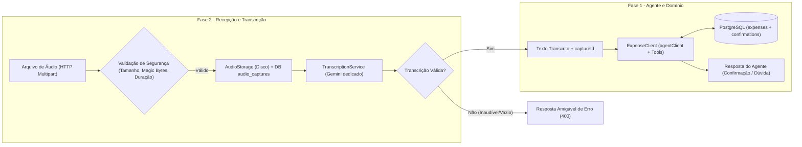
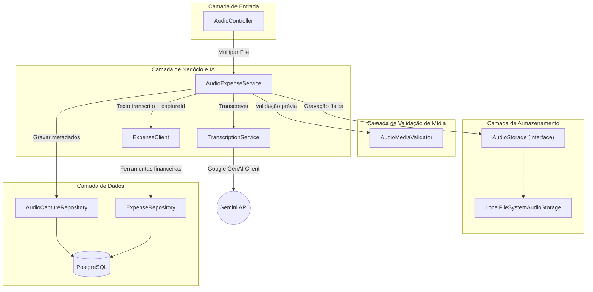
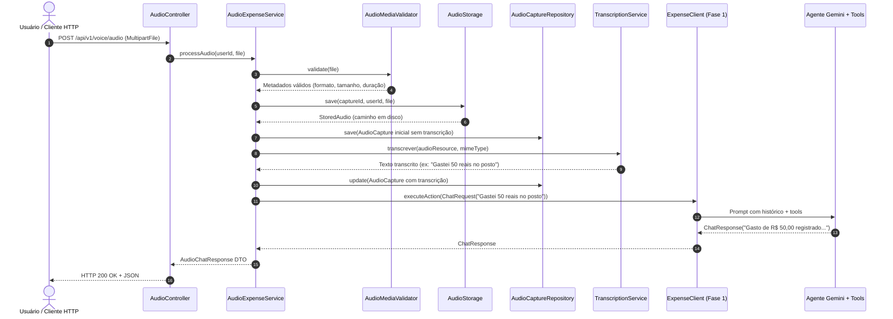
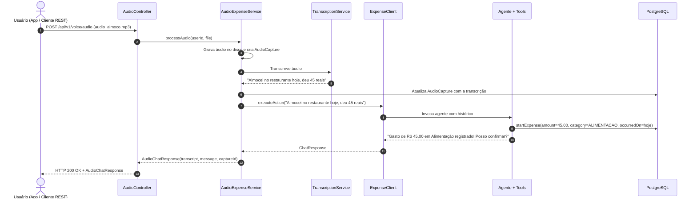
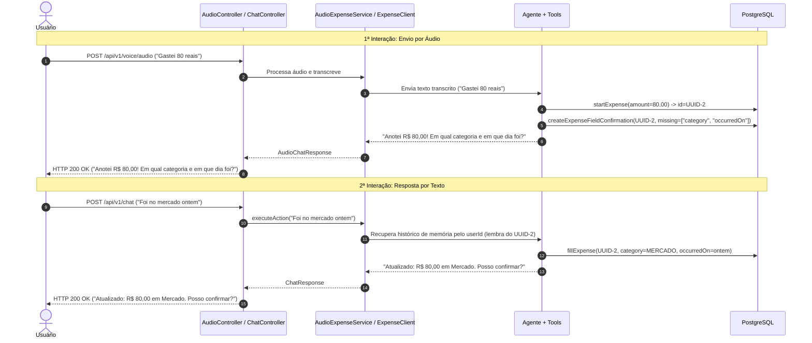
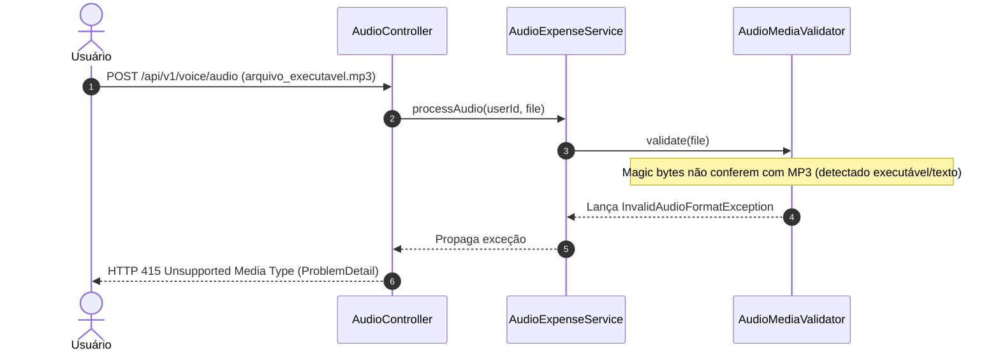
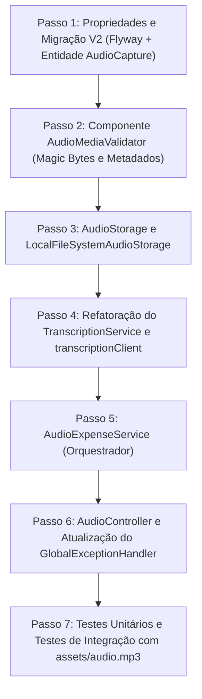

# Especificação Técnica: Fase 2 - Entrada por Áudio

Este documento estabelece a especificação técnica detalhada para a implementação da **Fase 2** no **VoiceFinance**, concentrando-se exclusivamente na camada de backend (API REST, validação de mídia, persistência, transcrição com IA e integração com o agente da Fase 1).

---

## 1. Visão Geral e Objetivos

A Fase 1 entregou o núcleo de conversação textual, o ciclo de vida da despesa (`PENDING_CONFIRMATION`, `CONFIRMED`, `CANCELED`), o mecanismo de esclarecimento de dúvidas e a persistência em PostgreSQL.

A **Fase 2** adiciona o canal de entrada por áudio à API:
1. **Recepção de Mídia**: Endpoint REST para recebimento de arquivos de áudio via `multipart/form-data`.
2. **Segurança e Validação de Mídia**: Validação rigorosa prévia à chamada de IA (tamanho, assinatura binária/magic bytes, duração máxima e integridade).
3. **Armazenamento de Áudio (`AudioStorage`)**: Gravação do arquivo bruto em sistema de arquivos local (com interface extensível para S3/Cloud Storage) e persistência de metadados em tabela dedicada (`audio_captures`).
4. **Transcrição Especializada**: Chamada ao modelo Gemini configurado exclusivamente para transcrição literal, sem ferramentas de negócio e sem histórico de memória conversacional.
5. **Orquestração com o Agente**: Encaminhamento do texto transcrito diretamente para o pipeline do agente da Fase 1, mantendo a rastreabilidade do áudio através do `captureId` e da origem `AUDIO`.



---

## 2. Arquitetura da Solução

### 2.1 Diagrama de Componentes



### 2.2 Papéis e Responsabilidades dos Componentes

| Componente | Pacote | Responsabilidade |
| :--- | :--- | :--- |
| [`AudioController`](file:///C:/Users/guima/OneDrive/Documentos/projects/voicefinance/src/main/java/com/voicefinance/controller/AudioController.java) | `com.voicefinance.controller` | Expõe `POST /api/v1/voice/audio`, delega ao serviço orquestrador e devolve a resposta padronizada. |
| `AudioMediaValidator` | `com.voicefinance.service.audio` | Valida integridade do arquivo, tamanho máximo, assinatura binária (*magic bytes*) e duração antes do envio à IA. |
| `AudioStorage` | `com.voicefinance.service.storage` | Interface de abstração para gravação, leitura e remoção de arquivos binários de áudio. |
| `LocalFileSystemAudioStorage` | `com.voicefinance.service.storage` | Implementação que armazena os arquivos no disco local em diretório estruturado por usuário e data. |
| `AudioCapture` | `com.voicefinance.domain.entity` | Entidade JPA que mapeia o registro da captura de áudio com metadados e transcrição. |
| `AudioCaptureRepository` | `com.voicefinance.repository` | Repositório Spring Data JPA para a entidade `AudioCapture`. |
| [`TranscriptionService`](file:///C:/Users/guima/OneDrive/Documentos/projects/voicefinance/src/main/java/com/voicefinance/service/TranscriptionService.java) | `com.voicefinance.service` | Executa a chamada multimodal ao Gemini utilizando `transcriptionClient` (sem memória e sem ferramentas). |
| `AudioExpenseService` | `com.voicefinance.service.audio` | Orquestra o fluxo ponta a ponta: validação, gravação física, persistência de captura, transcrição e acionamento do agente. |

---

## 3. Validação de Mídia e Segurança

Antes de qualquer comunicação com o modelo de inteligência artificial, o arquivo de áudio deve ser minuciosamente inspecionado para prevenir custos desnecessários, ataques de negação de serviço e envio de executáveis disfarçados.

### 3.1 Regras de Validação

1. **Arquivo não vazio**:
   - `file.isEmpty() == false` e `file.getSize() > 0`.
   - Se vazio: HTTP `400 Bad Request` com código `AUDIO_EMPTY`.

2. **Limite de Tamanho**:
   - Limite configurável em propriedade (padrão: 10 MB).
   - Configuração no Spring Boot: `spring.servlet.multipart.max-file-size=10MB` e `spring.servlet.multipart.max-request-size=10MB`.
   - Validação explícita no serviço: se `file.getSize() > maxSizeBytes`, retornar HTTP `413 Payload Too Large` com código `AUDIO_TOO_LARGE`.

3. **Formatos Permitidos e Inspeção de Assinatura Binária (*Magic Bytes*)**:
   - Não confiar apenas no header `Content-Type` enviado pelo cliente nem na extensão do arquivo.
   - Os primeiros bytes do arquivo devem ser lidos e comparados com assinaturas conhecidas:

| Formato | Extensões | Mime-Types Aceitos | Assinatura Binária (*Magic Bytes*) |
| :--- | :--- | :--- | :--- |
| **MP3** | `.mp3` | `audio/mpeg`, `audio/mp3` | `ID3` (0x49 0x44 0x33) ou frame sync `0xFF 0xFB`, `0xFF 0xF3`, `0xFF 0xF2` |
| **WAV** | `.wav` | `audio/wav`, `audio/x-wav` | `RIFF` (0x52 0x49 0x46 0x46) nos bytes 0-3 e `WAVE` (0x57 0x41 0x56 0x45) nos bytes 8-11 |
| **OGG** | `.ogg`, `.oga` | `audio/ogg`, `application/ogg` | `OggS` (0x4F 0x67 0x67 0x53) |
| **WebM** | `.webm` | `audio/webm` | `0x1A 0x45 0xDF 0xA3` (cabeçalho EBML/Matroska) |
| **M4A / AAC** | `.m4a`, `.aac`, `.mp4` | `audio/mp4`, `audio/x-m4a`, `audio/aac` | `ftyp` (0x66 0x74 0x79 0x70) a partir do byte 4 |

- Se a assinatura binária não corresponder a nenhum formato aceito: HTTP `415 Unsupported Media Type` com código `AUDIO_FORMAT_UNSUPPORTED`.

4. **Duração Máxima do Áudio**:
   - Duração máxima configurável (padrão: 60 segundos).
   - Extração via leitura do cabeçalho de áudio utilizando Java Sound API (`AudioSystem.getAudioFileFormat`) ou leitor de cabeçalhos de quadros de mídia.
   - Caso a duração ultrapasse o limite configurado: HTTP `400 Bad Request` com código `AUDIO_DURATION_EXCEEDED`.

---

## 4. Armazenamento de Arquivos (`AudioStorage`)

### 4.1 Interface `AudioStorage`

```java
package com.voicefinance.service.storage;

import org.springframework.core.io.Resource;
import org.springframework.web.multipart.MultipartFile;
import java.util.UUID;

public interface AudioStorage {
    StoredAudio save(UUID captureId, UUID userId, MultipartFile file, String extension);
    Resource load(String storagePath);
    void delete(String storagePath);
}
```

O registro `StoredAudio` encapsula o resultado da gravação:
```java
public record StoredAudio(
        String storagePath,
        long sizeBytes,
        String originalFilename,
        String detectedMimeType
) {}
```

### 4.2 Implementação em Sistema de Arquivos Local (`LocalFileSystemAudioStorage`)

- **Diretório Raiz**: Configurável via `voicefinance.audio.storage-dir` (padrão: `./storage/audio`).
- **Estrutura de Pastas**: `./storage/audio/{userId}/{yyyy-MM}/{captureId}.{ext}`.
- **Segurança de Caminho**: Tratamento estrito contra *Path Traversal* (impedir sequências `..` e caracteres proibidos no sistema de arquivos).
- **Extensibilidade**: A interface `AudioStorage` permite criar no futuro uma implementação `S3AudioStorage` sem alterar nenhuma classe de serviço ou controller.

---

## 5. Modelo de Dados e Persistência

### 5.1 Migração Flyway: `V2__create_audio_captures_table.sql`

O script cria a tabela `audio_captures` e ajusta a tabela `expenses` para que `capture_id` seja uma chave estrangeira opcional (permitindo despesas manuais com `capture_id = null`):

```sql
-- 1. Criação da tabela de capturas de áudio
CREATE TABLE audio_captures
(
    id                UUID                           NOT NULL,
    user_id           UUID                           NOT NULL,
    content_type      VARCHAR(100)                   NOT NULL,
    size_bytes        BIGINT                         NOT NULL,
    duration_seconds  NUMERIC(6, 2),
    original_filename VARCHAR(255),
    storage_path      VARCHAR(500)                   NOT NULL,
    transcript        TEXT,
    created_at        TIMESTAMP(6) WITHOUT TIME ZONE NOT NULL,
    CONSTRAINT pk_audio_captures PRIMARY KEY (id)
);

CREATE INDEX idx_audio_captures_user_id ON audio_captures (user_id);
CREATE INDEX idx_audio_captures_created_at ON audio_captures (created_at DESC);

-- 2. Ajuste da tabela expenses para suportar captura vinculada
ALTER TABLE expenses
    ALTER COLUMN capture_id DROP NOT NULL;

ALTER TABLE expenses
    ADD CONSTRAINT fk_expenses_audio_capture
    FOREIGN KEY (capture_id) REFERENCES audio_captures (id)
    ON DELETE SET NULL;
```

### 5.2 Entidade `AudioCapture`

```java
package com.voicefinance.domain.entity;

import jakarta.persistence.*;
import lombok.*;
import java.io.Serializable;
import java.math.BigDecimal;
import java.time.Instant;
import java.util.UUID;

@Entity
@Getter
@Setter
@Builder
@NoArgsConstructor
@AllArgsConstructor
@Table(name = "audio_captures")
public class AudioCapture implements Serializable {

    @Id
    private UUID id;

    @Column(name = "user_id", nullable = false)
    private UUID userId;

    @Column(name = "content_type", nullable = false, length = 100)
    private String contentType;

    @Column(name = "size_bytes", nullable = false)
    private Long sizeBytes;

    @Column(name = "duration_seconds", precision = 6, scale = 2)
    private BigDecimal durationSeconds;

    @Column(name = "original_filename", length = 255)
    private String originalFilename;

    @Column(name = "storage_path", nullable = false, length = 500)
    private String storagePath;

    @Column(name = "transcript", columnDefinition = "TEXT")
    private String transcript;

    @Column(name = "created_at", nullable = false)
    private Instant createdAt;

    @PrePersist
    private void prePersist() {
        if (this.createdAt == null) {
            this.createdAt = Instant.now();
        }
    }
}
```

---

## 6. Serviço de Transcrição (`TranscriptionService`)

O serviço de transcrição é dedicado exclusivamente à conversão de áudio em texto em português do Brasil.

### 6.1 Configuração do `transcriptionClient` em `ChatClientConfig`

O bean `transcriptionClient` deve ser ajustado para atender aos seguintes requisitos técnicos:
1. **Sem advisors de memória**: Transcrição não mantém estado nem histórico de conversação. O parâmetro de conversa deve ser removido.
2. **Sem ferramentas**: Remover `dateTimeTools` ou qualquer outra tool de negócio desse client. Transcrição não deve invocar *function calling*.
3. **Temperatura 0.0**: Assegurar fidelidade máxima ao que foi falado.
4. **Instrução de Sistema Direta**:
   ```text
   Você transcreve áudio em português brasileiro literalmente.
   Responda apenas com a transcrição textual exata do áudio, sem introduções, sem saudações e sem comentários adicionais.
   ```

### 6.2 Resiliência com Resilience4j

A chamada ao modelo de transcrição é envolvida por resiliência:
- **Retry**: Até 3 tentativas com backoff exponencial para falhas de rede ou limites transitórios de taxa (HTTP 429 ou 503).
- **Circuit Breaker**: Proteção contra indisponibilidade prolongada do serviço de GenAI.
- **TimeLimiter**: Timeout máximo de 30 segundos por requisição de áudio.

### 6.3 Tratamento de Áudio Inaudível ou Transcrição Vazia

Se a transcrição retornada pelo modelo for nula, vazia ou contiver apenas pontuação/ruído (ex.: `"..."`, `"[música]"`, `"[silêncio]"`):
- O pipeline é interrompido imediatamente.
- O agente da Fase 1 **não** é acionado (economizando tokens e evitando falsos cadastros).
- O endpoint retorna HTTP `400 Bad Request` com a mensagem: *"Não foi possível identificar nenhuma fala com clareza no áudio enviado. Por favor, tente gravar novamente."*

---

## 7. Orquestração e Integração com a Fase 1

O componente `AudioExpenseService` une os blocos no seguinte fluxo:



### 7.1 Passos do Fluxo no `AudioExpenseService`

1. **Obter `userId`**: Recuperado do `CurrentUserProvider` (`DevCurrentUserProvider` ou header `X-User-Id`).
2. **Gerar `captureId`**: `UUID.randomUUID()`.
3. **Validar Mídia**: `AudioMediaValidator.validate(file)` valida tamanho, *magic bytes* e duração. Lança exceções mapeadas se inválido.
4. **Gravar Arquivo**: `AudioStorage.save(...)` persiste o binário no disco local.
5. **Criar Entidade `AudioCapture`**: Salva o registro no banco com status inicial e metadados.
6. **Executar Transcrição**: `TranscriptionService.transcrever(...)` processa o arquivo via Gemini.
7. **Verificar Qualidade da Transcrição**: Interrompe se a transcrição estiver vazia ou inaudível.
8. **Atualizar `AudioCapture`**: Grava o texto transcrito no banco de dados.
9. **Invocar o Agente da Fase 1**: Dispara `ExpenseClient.executeAction(new ChatRequest(transcricao))`. O agente mantém a conversa no contexto do `userId`, utiliza o `ChatMemory` existente e chama as ferramentas (`startExpense`, `createExpenseFieldConfirmation`, etc.).
10. **Montar e Retornar `AudioChatResponse`**: Retorna objeto estruturado com a transcrição, a mensagem do agente e os metadados do áudio.

---

## 8. Contrato da API REST

### 8.1 Endpoint Principal

- **Método**: `POST`
- **Caminho**: `/api/v1/voice/audio`
- **Content-Type**: `multipart/form-data`
- **Parâmetros**:
  - `file`: Arquivo binário de áudio (obrigatório).
- **Headers Opcionais**:
  - `X-User-Id`: UUID do usuário (utilizado para simulação ou testes; padrão de desenvolvimento já configurado).

### 8.2 DTOs de Requisição e Resposta

#### `AudioChatResponse` (HTTP 200 OK)
```json
{
  "captureId": "4a71b267-33b8-4e89-a28c-76e33f6a2b85",
  "transcript": "Almocei no restaurante hoje, deu 45 reais",
  "message": "Gasto de R$ 45,00 em Alimentação registrado com sucesso! Posso confirmar?",
  "durationSeconds": 4.15,
  "sizeBytes": 205721,
  "contentType": "audio/mpeg",
  "createdAt": "2026-10-09T18:35:10.123Z"
}
```

### 8.3 Mapeamento de Erros (RFC 7807 `ProblemDetail`)

Todas as falhas retornam a estrutura padrão `ProblemDetail` tratada em [`GlobalExceptionHandler`](file:///C:/Users/guima/OneDrive/Documentos/projects/voicefinance/src/main/java/com/voicefinance/exception/GlobalExceptionHandler.java):

#### Exemplo 1: Arquivo Muito Grande (HTTP 413)
```json
{
  "type": "about:blank",
  "title": "Payload Too Large",
  "status": 413,
  "detail": "O arquivo de áudio excede o limite máximo permitido de 10 MB.",
  "timestamp": "2026-10-09T18:35:10.123Z",
  "errorCode": "AUDIO_TOO_LARGE"
}
```

#### Exemplo 2: Formato Não Suportado / Assinatura Binária Inválida (HTTP 415)
```json
{
  "type": "about:blank",
  "title": "Unsupported Media Type",
  "status": 415,
  "detail": "Formato de arquivo não suportado. Envie arquivos MP3, WAV, OGG, WebM ou M4A válidos.",
  "timestamp": "2026-10-09T18:35:10.123Z",
  "errorCode": "AUDIO_FORMAT_UNSUPPORTED"
}
```

#### Exemplo 3: Duração Acima do Permitido (HTTP 400)
```json
{
  "type": "about:blank",
  "title": "Audio Duration Exceeded",
  "status": 400,
  "detail": "A duração do áudio (85.2s) excede o limite máximo permitido de 60 segundos.",
  "timestamp": "2026-10-09T18:35:10.123Z",
  "errorCode": "AUDIO_DURATION_EXCEEDED"
}
```

#### Exemplo 4: Áudio Inaudível ou Ruído Sem Fala (HTTP 400)
```json
{
  "type": "about:blank",
  "title": "Transcription Inaudible",
  "status": 400,
  "detail": "Não foi possível identificar nenhuma fala com clareza no áudio enviado.",
  "timestamp": "2026-10-09T18:35:10.123Z",
  "errorCode": "AUDIO_INAUDIBLE"
}
```

---

## 9. Cenários de Uso e Sequência de Mensagens

### Cenário 1: Áudio Completo com Registro de Gasto Direto



### Cenário 2: Áudio com Informações Faltantes (Esclarecimento Posterior por Texto)

O usuário envia um áudio informando apenas o valor. Em seguida, responde à dúvida do agente através do endpoint de texto da Fase 1 (`POST /api/v1/chat`), comprovando que o histórico de conversação é mantido íntegro e compartilhado por `userId`:



### Cenário 3: Áudio Rejeitado por Assinatura Binária Inválida



---

## 10. Configuração da Aplicação (`application.yaml`)

As propriedades devem ser organizadas de forma limpa, unificando os prefixos e assegurando conformidade com `AiModelsProperties`:

```yaml
spring:
  application:
    name: voicefinance
  config:
    import: optional:file:./.env[.properties]
  servlet:
    multipart:
      enabled: true
      max-file-size: 10MB
      max-request-size: 10MB
  datasource:
    url: ${SPRING_DATASOURCE_URL:jdbc:postgresql://localhost:5432/voicefinance}
    username: ${SPRING_DATASOURCE_USERNAME:postgres}
    password: ${SPRING_DATASOURCE_PASSWORD:admin}
    driver-class-name: org.postgresql.Driver
  jpa:
    hibernate:
      ddl-auto: validate
  flyway:
    enabled: true
  ai:
    google:
      genai:
        api-key: ${GOOGLE_GENAI_APIKEY}

# Configurações do VoiceFinance
voicefinance:
  ai:
    transcription-model: ${AI_TRANSCRIPTION_MODEL:gemini-3.5-transcription}
    agent-model: ${AI_AGENT_MODEL:gemini-3.1-flash-lite}
  audio:
    storage-dir: ${AUDIO_STORAGE_DIR:./storage/audio}
    max-file-size-bytes: 10485760 # 10 MB
    max-duration-seconds: 60
    allowed-content-types:
      - audio/mpeg
      - audio/mp3
      - audio/wav
      - audio/x-wav
      - audio/ogg
      - audio/webm
      - audio/mp4
      - audio/x-m4a
      - audio/aac

resilience4j:
  retry:
    instances:
      transcriptionRetry:
        max-attempts: 3
        wait-duration: 1000ms
        exponential-backoff-multiplier: 2
        retry-exceptions:
          - org.springframework.web.client.ResourceAccessException
          - com.google.genai.errors.ServerException
  circuitbreaker:
    instances:
      transcriptionCircuit:
        sliding-window-size: 10
        failure-rate-threshold: 50
        wait-duration-in-open-state: 10000ms
```

> [!NOTE]
> A classe [`AiModelsProperties`](file:///C:/Users/guima/OneDrive/Documentos/projects/voicefinance/src/main/java/com/voicefinance/ai/config/AiModelsProperties.java) deve ter seu prefixo alinhado para `@ConfigurationProperties(prefix = "voicefinance.ai")`, garantindo a injeção correta de `transcriptionModel` e `agentModel`.

---

## 11. Estratégia de Testes Automatizados

A suíte de testes deve cobrir a validação de mídia, o armazenamento e a integração HTTP:

### 11.1 Testes Unitários

1. **`AudioMediaValidatorTest`**:
   - Validação de arquivo MP3 autêntico (ex.: [assets/audio.mp3](file:///C:/Users/guima/OneDrive/Documentos/projects/voicefinance/assets/audio.mp3)).
   - Rejeição de arquivo com extensão `.mp3`, mas contendo texto simples ou cabeçalho de executável (*magic bytes* inválidos).
   - Rejeição de arquivo com tamanho superior a 10 MB.
   - Rejeição de arquivo com 0 bytes.
   - Rejeição de áudio com duração superior a 60 segundos.

2. **`LocalFileSystemAudioStorageTest`**:
   - Criação de diretórios automática e gravação bem-sucedida de arquivo em disco.
   - Verificação de segurança contra nomes com sequências maliciosas de diretório (`../../`).
   - Carregamento do arquivo gravado e comparação de integridade de bytes.
   - Exclusão do arquivo e limpeza.

3. **`TranscriptionServiceTest`**:
   - Mock do `ChatClient` retornando transcrição válida.
   - Teste de interceptação de resposta em branco ou inaudível lançando `InaudibleAudioException`.

### 11.2 Testes de Integração de API (`AudioControllerTest`)

Utilizando `MockMvc` com perfil de testes e banco PostgreSQL de testes:
- `POST /api/v1/voice/audio` com arquivo válido ([assets/audio.mp3](file:///C:/Users/guima/OneDrive/Documentos/projects/voicefinance/assets/audio.mp3)) e `ExpenseClient` mockado:
  - Deve retornar HTTP `200 OK` com `AudioChatResponse`.
  - Deve verificar a persistência do registro em `audio_captures`.
- `POST /api/v1/voice/audio` sem arquivo ou campo `file` ausente:
  - Deve retornar HTTP `400 Bad Request`.
- `POST /api/v1/voice/audio` com arquivo corrompido:
  - Deve retornar HTTP `415 Unsupported Media Type`.
- `POST /api/v1/voice/audio` quando a transcrição for vazia:
  - Deve retornar HTTP `400 Bad Request` com código `AUDIO_INAUDIBLE`.

---

## 12. Roteiro de Implementação Passo a Passo

A implementação da Fase 2 deve seguir rigorosamente a sequência de dependências abaixo:



| Passo | Tarefa | Arquivos Impactados |
| :--- | :--- | :--- |
| **1** | Criar migração Flyway `V2`, entidade `AudioCapture`, `AudioCaptureRepository` e ajustar prefixo em `AiModelsProperties`. | `V2__create_audio_captures_table.sql`, `AudioCapture.java`, `AudioCaptureRepository.java`, `AiModelsProperties.java`, `Expense.java` |
| **2** | Implementar `AudioMediaValidator` com verificação de tamanho, magic bytes e duração. Criar exceções de domínio correspondentes. | `AudioMediaValidator.java`, `InvalidAudioFormatException.java`, `AudioTooLargeException.java`, `AudioDurationExceededException.java`, `EmptyAudioException.java` |
| **3** | Implementar interface `AudioStorage` e classe `LocalFileSystemAudioStorage`. | `AudioStorage.java`, `StoredAudio.java`, `LocalFileSystemAudioStorage.java` |
| **4** | Refatorar `ChatClientConfig` (remover ferramentas e histórico do `transcriptionClient`) e atualizar `TranscriptionService` para usar resiliência e validação de fala inaudível. | `ChatClientConfig.java`, `TranscriptionService.java`, `InaudibleAudioException.java` |
| **5** | Implementar `AudioExpenseService` integrando validação, armazenamento, transcrição, persistência de metadados e chamada ao `ExpenseClient`. | `AudioExpenseService.java`, `AudioChatResponse.java` |
| **6** | Implementar `AudioController.audio(...)` com Swagger OpenAPI e tratar novas exceções de áudio em `GlobalExceptionHandler`. | `AudioController.java`, `GlobalExceptionHandler.java` |
| **7** | Implementar suíte completa de testes unitários e de integração (`AudioMediaValidatorTest`, `LocalFileSystemAudioStorageTest`, `AudioControllerTest`). | `src/test/java/...` |
