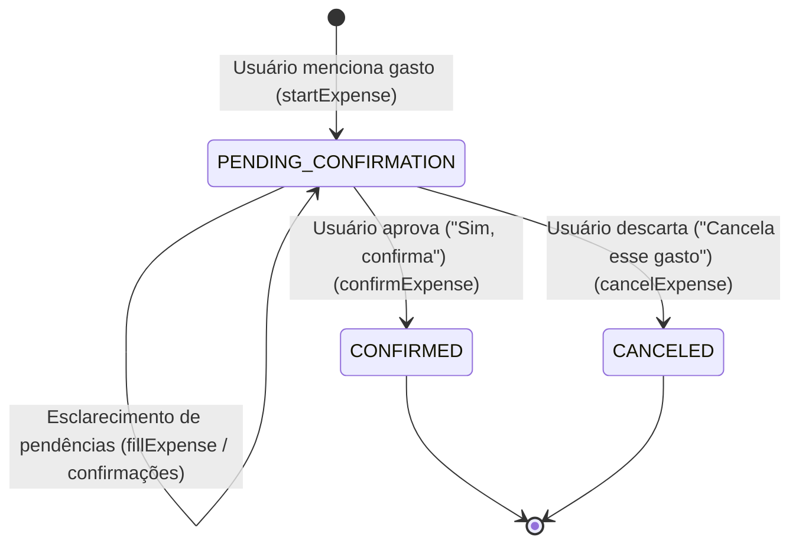
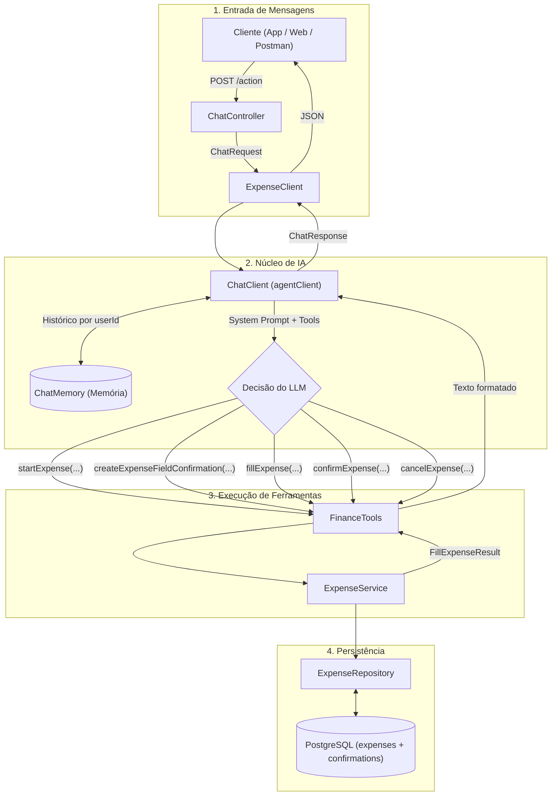
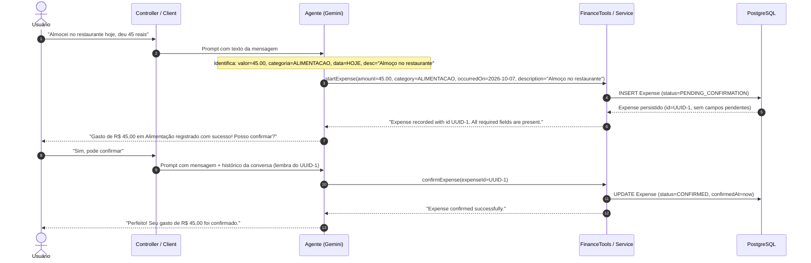
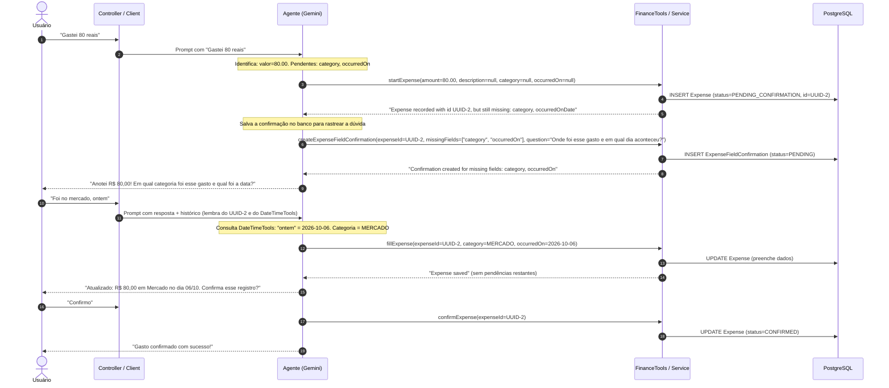
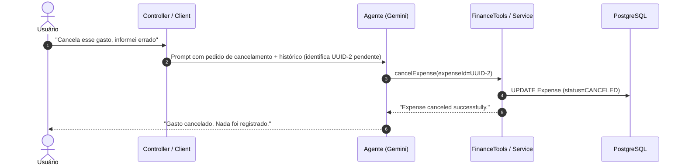

# Fluxo de Mensagens e Arquitetura do Agente: Fase 1 (Texto)

Este documento define a arquitetura, o ciclo de vida do gasto e a sequência de mensagens do agente no **VoiceFinance** para a Fase 1 (entrada puramente textual).

---

## 1. Ciclo de Vida do Gasto (Máquina de Estados)

Um registro de gasto transita por três estados ao longo da conversa:

### Regras de Transição
- **`PENDING_CONFIRMATION`**:
  - Estado inicial atribuído no momento da criação do gasto.
  - Permite edições incrementais (`isEditable() == true`).
  - Pode ter uma ou mais confirmações vinculadas com status `PENDING`.
- **`CONFIRMED`**:
  - Transição permitida somente quando todos os dados obrigatórios estão preenchidos e o usuário deu confirmação expressa.
  - O registro torna-se imutável (`isEditable() == false`).
- **`CANCELED`**:
  - Acionado se o usuário manifestar arrependimento ou desistência do lançamento. Também imutável.

---

## 2. Arquitetura da Fase 1

---

## 3. Cenários Conversacionais Passo a Passo

### Cenário A: Gasto com Dados Completos em Mensagem Única
O usuário fornece todos os dados necessários de forma direta.

---

### Cenário B: Gasto com Dados Incompletos (Rodadas de Esclarecimento)
O usuário fala apenas o valor, omitindo categoria ou data.

---

### Cenário C: Descarte ou Cancelamento
O usuário decide não registrar o gasto que estava em andamento.

---

## 4. Conjunto de Ferramentas (Tools) da Fase 1

O conjunto completo de ferramentas em [`FinanceTools`](file:///C:/Users/guima/OneDrive/Documentos/projects/voicefinance/src/main/java/com/voicefinance/tools/FinanceTools.java):

| Ferramenta | Parâmetros | Finalidade |
| :--- | :--- | :--- |
| **`startExpense`** | `amount`, `currency`, `description`, `category`, `occurredOn` (todos opcionais) | Inicia um novo gasto no banco com status `PENDING_CONFIRMATION` e devolve o `expenseId` gerado. Chamada no primeiro contato de uma nova despesa. |
| **`createExpenseFieldConfirmation`** | `expenseId`, `missingFields`, `question` | Registra no banco uma dúvida formal do agente sobre campos pendentes antes de perguntar ao usuário. |
| **`fillExpense`** | `expenseId`, `amount`, `currency`, `description`, `category`, `occurredOn` | Aplica novos dados trazidos pelo usuário em um gasto já existente. |
| **`confirmExpense`** | `expenseId` | Efetiva o gasto, alterando o status para `CONFIRMED` e gravando o timestamp de confirmação. |
| **`cancelExpense`** | `expenseId` | Cancela o gasto pendente, alterando o status para `CANCELED`. |

---

## 5. Roteiro de Implementação da Fase 1

1. **Ferramenta `startExpense`**:
   - Criação de `StartExpenseCommand`.
   - Implementação de `startExpense(...)` em `ExpenseService`.
   - Adição da `@Tool startExpense` em `FinanceTools`.
2. **Ferramentas `confirmExpense` e `cancelExpense`**:
   - Métodos em `ExpenseService` para transição de status (`CONFIRMED` com timestamp e `CANCELED`).
   - Tools correspondentes em `FinanceTools`.
3. **Atualização do System Prompt do Agente**:
   - Ajustar as instruções do modelo em `ChatClientConfig` para orquestrar as ferramentas seguindo o ciclo:
     1. Menção a novo gasto ➔ chamar `startExpense`.
     2. Dados faltantes ➔ chamar `createExpenseFieldConfirmation` e perguntar ao usuário.
     3. Dados complementados ➔ chamar `fillExpense`.
     4. Aprovação do usuário ➔ chamar `confirmExpense`.
     5. Rejeição do usuário ➔ chamar `cancelExpense`.
4. **Testes Automatizados**:
   - Testes unitários para as novas tools e métodos de serviço.
   - Testes simulando os fluxos conversacionais dos Cenários A, B e C.
